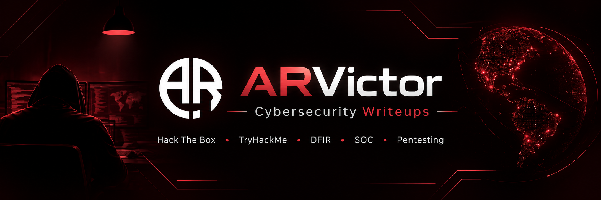

# ARVictor | Cybersecurity Writeups

My notes from hands-on cybersecurity labs. I write down the steps I took, the evidence I found, and what I learned.

## Write-ups

| Lab | Platform | Topic | Status |
| --- | --- | --- | --- |
| [Cache Me Outside](tryhackme/rooms/cache-me-outside/README.md) | TryHackMe | OSINT | Published |
| [Missing Person](tryhackme/rooms/missing-person/README.md) | TryHackMe | OSINT | Published |
| [Baggage](hackthebox/sherlocks/very-easy/baggage/README.md) | Hack The Box Sherlock | Windows Shellbag forensics | Draft — screenshots pending |

The two TryHackMe pages are adapted from my Medium posts. Their screenshots remain linked from the original articles.

## Browse

- [Hack The Box](hackthebox/README.md) — lab index
- [TryHackMe](tryhackme/README.md) — room index
- [Writing template](templates/README.md) — a starting point for a new write-up
- [Resources](resources/README.md) — my writing and evidence checklist

## How I write

Each write-up explains the lab goal, the tools I used, the important steps, the evidence, and the lesson I learned. Screenshots go in an `images/` folder beside that write-up. I use short, descriptive file names such as `01-initial-scan.png`.

**ARVictor** is my name for cybersecurity labs and learning. This archive covers work I do in authorized lab environments. I share solutions only when the platform allows it, and I remove secrets and personal information before publishing.
